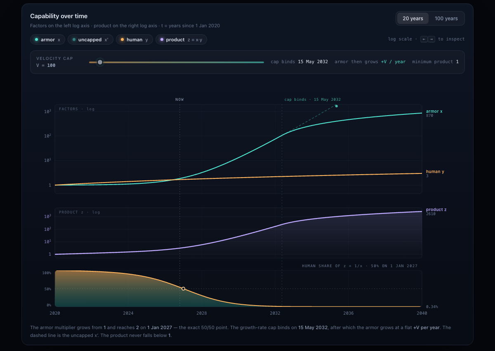

# The AI Armor

<p align="center">
  <a href="https://emircanerkul.github.io/the-ai-armor/"><b>Open the website →</b></a>
</p>

A single-page model of how an AI layer that **multiplies** human capability ends up **suppressing the human share** of the outcome.

**The claim:** suppression of this kind does not require the AI to be hostile, or the person to get worse. It follows from the shape of the multiplication alone. Every quantity a person cares about — their own capability, the total output, the quality of the result — can be improving at the same time that their share of the outcome collapses toward zero.

> **The developer is not replaced by a better developer. The developer is replaced by the customer.**


---

## The idea

A hammer cannot drive a nail by itself. Its output is bounded by the arm that swings it, so the person remains the deciding term. That is why `human × tool` behaves sensibly for ordinary tools: the tool's factor is roughly a constant near one, and skill dominates.

**The AI armor is not a hammer.** It is a layer that multiplies what a person can do, and the multiplier grows on its own. Two consequences follow:

1. **The armor can prompt itself.** Once it generates the next step without waiting on the user's skill, knowledge of the domain stops being leverage. The user needs only to articulate what they want; the armor supplies the expertise. The advantage that survives is the ability to state intent, not the ability to execute.
2. **The human share falls, not the human.** The person improves, the total improves, and the ratio between them collapses anyway. That is the part that is easy to miss.

The person stays in the loop. They just stop being the reason the loop produces anything.

---

## The chart



Three aligned panels on a shared time axis:

- **Factors** (log) — armor `x`, human `y`, and the uncapped `x′` for reference
- **Product `z`** (log) — rises monotonically, never below 1
- **Human share** (linear) — exactly `1/x`, crossing 50% on 1 Jan 2027

Hover or use `←`/`→` to inspect any date. Click a legend chip to isolate a series. Toggle between the 20-year and 100-year spans. The velocity cap `V` is a live slider (10–2000).

---

## Where it surfaces

Dilution is a ratio, but ratios become prices.

| step | what happens |
|---|---|
| **1. The armor gets cheap** | What needed a team, a budget and years of skill now needs one person, a clear description, and a subscription. |
| **2. Competition arrives from everywhere** | One person with the armor ships a whole product. The barrier that stopped them was never ambition — it was capability. |
| **3. Prices fall toward the new cost** | With execution supply effectively unbounded, prices stop reflecting difficulty and start reflecting how cheaply something can be rebuilt. The margin *was* the difficulty. |
| **4. Firms shrink without doing anything wrong** | A firm built on selling execution competes with the customers who used to buy it. Nobody was replaced; the market stopped needing forty people to produce the same thing. |
| **5. Knowledge workers lose the premium on knowledge** | Software developers are the clearest case. When the armor supplies the *how*, the scarce input becomes the *what* — judgement about what should exist and why. |

Each step reads as a local market story. Together they are one curve: the human share of the **work** falls, then of the **price**, then of **headcount**.

---

## The model

Three terms and one free parameter.

```
t = now − 2020

y = b · (1 + 0.1t)                        human capability — grows, never falls
x = 1 + cap((t/7)^(2 + 0.5t), V)          armor multiplier — starts at 1, compounds
z = x · y                                 product
```

with `A = B = 1`.

### Why the armor term is written this way

**It starts at identity.** `x = 1` at `t = 0`: the armor neither helps nor harms. A multiplier that dips below 1 would be *reducing* capability, which is not what a multiplier does.

**It is pinned to the crossover.** The `(t/7)` normalisation makes the amplification term exactly 1 at `t = 7`, so `x = 2` on **1 January 2027**. Since the human share is exactly `1/x`, that is the precise 50/50 point — not an approximation.

**It has a velocity limit.** Uncapped, `t^(2 + 0.5t)` diverges. Capping the *growth rate* at `V` keeps the model physical: the armor compounds super-exponentially, then switches to straight-line growth at `+V` per year.

### Consequences that fall out of the algebra

| quantity | value | why |
|---|---|---|
| human share of `z` | `y/z = 1/x` | exact identity, since `z = x·y` |
| `z ≥ 1` | always | both factors are ≥ 1 |
| human majority until | 1 Jan 2027 | `x = 2` there |
| 10% human share | Aug 2029 | `x = 10` |

## Parameters

| symbol | default | meaning |
|---|---|---|
| `A`, `B` | `1` | unit scales for armor and human capability |
| `V` | `100` | growth-rate cap on the armor multiplier |
| `t_c` | `7` | crossover: the year the armor multiplier reaches 2 |

`V` is the only genuinely free parameter, and the page exposes it as a slider so the dependence can be inspected directly.

## Scope

This is an argument made inspectable, not a forecast. `b` and the `0.1` growth rate are placeholders; the shape of the curve is the point. The claim being tested is structural — that a self-compounding multiplier suppresses the human share regardless of how capable the human becomes — and that claim does not depend on the particular constants.
